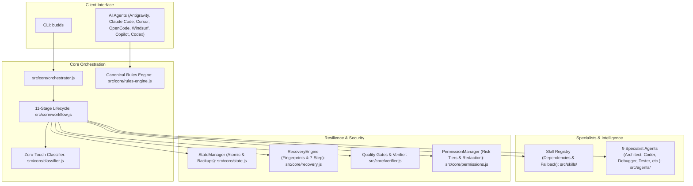
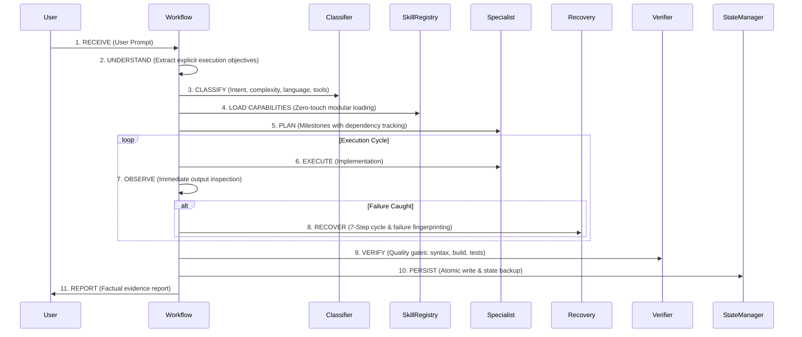

# BUDDS-RULES v2.0 Architecture Specification

## 1. Executive Architecture Overview

BUDDS-RULES is an autonomous execution framework and rules engine designed for modern AI pair programmers and agentic coding platforms. It shifts the paradigm from conversational back-and-forth to deterministic, evidence-based execution with zero babysitting.

---

## 2. The 11-Stage Autonomous Lifecycle

### Lifecycle States
At any point in time, execution exists in one of seven deterministic states:
- `PENDING`: Task queued or milestone waiting on dependencies.
- `RUNNING`: Active execution in progress.
- `RECOVERING`: Recoverable failure undergoing strategy pivot.
- `VERIFYING`: Execution completed, quality gates asserting outcomes.
- `COMPLETED`: Outcomes factually verified with exit 0 and evidence.
- `BLOCKED`: Genuine external dependency or security boundary halted.
- `FAILED`: Execution terminated after exhausting adaptive retry budget.

---

## 3. Core Engine Components

### 3.1 TaskClassifier v2.0 (`src/core/classifier.js`)
Classifies requests across 6 dimensions:
1. **User Intent**: Development, debugging, testing, research, automation, documentation, security audit.
2. **Task Complexity**: `simple`, `moderate`, `complex`, `architectural`.
3. **Programming Languages**: Detects JS, TS, Python, Go, Rust, PHP, Java, SQL, Shell.
4. **Frameworks**: Detects React, Next.js, Vue, Express, NestJS, Django, FastAPI, Laravel, Spring.
5. **Required Tools & Expertise**: Database, authentication, REST/GraphQL, DevOps.
6. **Automatic Skill Selection**: Activates minimal relevant capability set without manual slash commands.

### 3.2 StateManager v2.0 (`src/core/state.js`)
- **Atomic Writes**: Writes to temporary file before atomic rename (`state.tmp.*` -> `state.json`).
- **Corruption Resilience**: Automatically maintains `state.backup.json` and restores corrupted state files.
- **Interrupted Task Resumption**: Detects unfinished tasks (`hasInterruptedTask()`) and restores execution continuity (`resumeInterruptedTask()`).
- **Milestone Dependency Tracking**: Supports topological milestone resolution.
- **Execution Logging**: Maintains an append-only `.budds/execution.log` with automated secret sanitization.

### 3.3 RecoveryEngine v2.0 (`src/core/recovery.js`)
- **Failure Fingerprinting**: Computes MD5 hash signatures of `(category, rootSnippet, method)` to detect duplicate failing attempts.
- **7-Step Problem Solving**: Analyze -> Root Cause -> Reconsider -> Alternative Methods -> Implement -> Test -> Iterate.
- **Adaptive Retry Budget**: Calculates max attempts based on complexity (default: 15 cycles) to eliminate infinite loops.
- **Blocker Reports**: Produces human-readable remediation reports when encountering external policy boundaries.

### 3.4 PermissionManager (`src/core/permissions.js`)
- **Risk Tiers**:
  - `READ` (Tier 1): Safe workspace reads.
  - `WRITE` (Tier 2): Project scoped filesystem modifications.
  - `EXECUTE` (Tier 3): Command line executions.
  - `DANGEROUS` (Tier 4): Destructive deletions, system directory modifications.
- **Configuration Backups**: Automatically backs up files to `.budds/backups/` before modifications.
- **Secret Sanitization**: Redacts bearer tokens, API keys, passwords, and private keys.

---

## 4. Modular Specialist Agents (`src/agents/`)

BUDDS-RULES orchestrates 9 specialized agents:
1. **Architect** (`architect.js`): High-level system design and milestone breakdown.
2. **Coder / Developer** (`coder.js`): Production-ready implementation and clean code.
3. **Debugger** (`debugger.js`): Root-cause triage and 7-step error resolution.
4. **Researcher** (`researcher.js`): Intelligence gathering, API specs, and sitemaps.
5. **Tester** (`tester.js`): Automated unit, integration, and edge-case test suites.
6. **Reviewer** (`reviewer.js`): Code quality, maintainability, and code smell analysis.
7. **Security Reviewer** (`security.js`): Vulnerability triage, credential leaks, and auth auditing.
8. **Documentation Specialist** (`docs.js`): Technical specifications, diagrams, and guides.
9. **Automation Specialist** (`automation.js`): Cross-platform CLI, scripts, and CI/CD pipelines.

---

## 5. Universal AI Agent Adapters (`src/adapters/`)

Unified adapter contract v2:
- `detect(targetDir)`
- `install(targetDir, options)`
- `configure(targetDir, config)`
- `activate(targetDir)`
- `execute(targetDir, command, options)`
- `verify(targetDir)`
- `uninstall(targetDir, options)`
- `getCapabilities()`

Supported environments:
- **Google Antigravity IDE**: `AGENTS.md` (Canonical) + `GEMINI.md` (Adapter pointer).
- **Anthropic Claude Code**: `CLAUDE.md` in workspace root or `~/.claude/CLAUDE.md`.
- **Cursor IDE**: `.cursorrules` and `.cursor/rules/budds-rules.mdc`.
- **OpenCode**: `opencode.json` plugin registration.
- **Windsurf IDE**: `.windsurfrules`.
- **GitHub Copilot**: `.github/copilot-instructions.md`.
- **OpenAI Codex & Universal CLI**: `AGENTS.md`.
