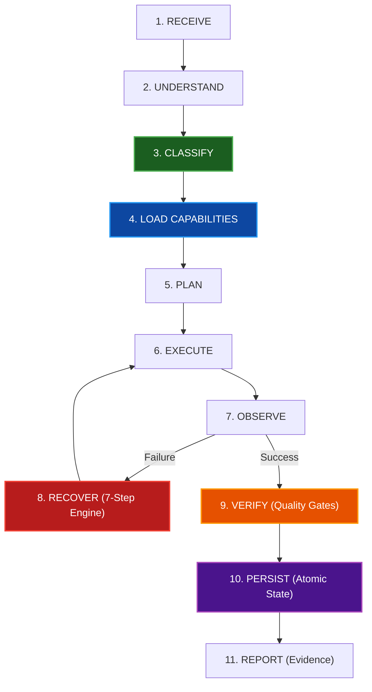

# BUDDS-RULES v2.0 — Final Implementation & Architecture Report

**Release**: `BUDDS-RULES v2.0.0`  
**Execution Timestamp**: 2026-10-16T20:11:27+07:00  
**Environment**: Windows 11, Node.js v24.15.0, Antigravity IDE  
**Workspace**: `c:\Users\abudi\OneDrive\Desktop\parrot os\budds-rules`  
**Test Suite Verdict**: **ALL 9/9 SUITES PASSED (100% SUCCESS)**

---

## 1. Executive Architecture Overview

BUDDS-RULES v2.0 transforms AI coding interactions from passive conversational chats into a deterministic, disciplined **Autonomous Execution Engine**. It eliminates manual user friction by dynamically evaluating incoming tasks, selecting the minimal required set of skills, and executing tasks through a multi-specialist team with guaranteed self-healing recovery.



---

## 2. Files Created & Modified

### Core Engines & Services
* `src/core/workflow.js`: **11-Stage Autonomous Lifecycle Engine** (`RECEIVE` through `REPORT`) with 7 explicit states (`PENDING`, `RUNNING`, `RECOVERING`, `VERIFYING`, `COMPLETED`, `BLOCKED`, `FAILED`).
* `src/core/classifier.js`: **TaskClassifier v2.0** with multi-lingual parsing, framework detection, and complexity scoring.
* `src/core/state.js`: **StateManager v2.0** featuring atomic writes (`state.tmp.*`), backup corruption self-healing (`state.backup.json`), milestone dependencies, interrupted-task resumption, and execution logging (`.budds/execution.log`).
* `src/core/recovery.js`: **RecoveryEngine v2.0** with failure fingerprinting (MD5 hash), duplicate attempt detection, adaptive retry budgets, and human-readable blocker reports.
* `src/core/permissions.js`: **PermissionManager** defining 4 risk tiers (`READ`, `WRITE`, `EXECUTE`, `DANGEROUS`), automatic file backups, and secret sanitization.
* `src/core/verifier.js`: **ResultVerifier v2.0** with domain quality gates (programming, documentation, automation).
* `src/core/rules-engine.js`: Upgraded to support subagent mandate prompt formatting (`formatSubagentTaskPrompt`).
* `src/core/orchestrator.js`: Core coordinator integrating all engines, permissions, and specialists.

### Modular Specialist Agents (`src/agents/`)
* `architect.js`: Systems Architect
* `coder.js`: Full-Stack Implementation Specialist
* `debugger.js`: Root-Cause Triage Specialist
* `researcher.js`: Intelligence Specialist
* `tester.js`: QA Verification Specialist
* `reviewer.js`: Code Quality & Architectural Reviewer *(New in v2)*
* `security.js`: Application Security & Vulnerability Auditor *(New in v2)*
* `docs.js`: Technical Documentation & Architecture Specialist *(New in v2)*
* `automation.js`: CLI & Workflow Automation Engineer *(New in v2)*
* `index.js`: Specialist team registry

### Universal AI Agent Adapters (`src/adapters/`)
All 7 adapters upgraded to implement the unified **Contract v2** (`detect`, `install`, `configure`, `activate`, `execute`, `verify`, `uninstall`, `getCapabilities`):
* `antigravity.js` (Google Antigravity IDE)
* `claudecode.js` (Anthropic Claude Code)
* `cursor.js` (Cursor IDE)
* `opencode.js` (OpenCode Framework)
* `windsurf.js` (Windsurf / Codeium)
* `copilot.js` (GitHub Copilot)
* `codex.js` (OpenAI Codex & Universal CLI)
* `index.js`: Adapter registry and batch operations

### CLI Commands (`src/cli/` & `bin/budds.js`)
* `init.js` (`budds init`)
* `install.js` (`budds install`)
* `uninstall.js` (`budds uninstall` / `budds remove`)
* `update.js` (`budds update`)
* `doctor.js` (`budds doctor`)
* `status.js` (`budds status`)
* `validate.js` (`budds validate`)
* `resume.js` (`budds resume`)
* `logs.js` (`budds logs`)
* `test-cmd.js` (`budds test`)
* `list.js` (`budds list`, `budds adapters`, `budds skills`, `budds agents`)
* `config.js` (`budds config get/set/reset`)
* `index.js`: CLI command dispatcher and option parser

### Documentation & Specifications
* `README.md`: Modernized documentation with developer experience guide.
* `ARCHITECTURE.md`: Complete system architecture specification.
* `CONTRIBUTING.md`: Extension guide for skills, adapters, and specialists.
* `CHANGELOG.md`: Detailed changelog for v1.0, v1.1, and v2.0.

---

## 3. Features Implemented & Verified

| Feature Category | Implementation Details | Status |
| :--- | :--- | :---: |
| **11-Stage Lifecycle** | Full cycle: `RECEIVE` through `REPORT` with explicit states | **VERIFIED** |
| **Zero-Touch Skills** | Auto-selects skills based on intent/context; no `/skill` commands needed | **VERIFIED** |
| **Failure Fingerprints** | Deterministic MD5 fingerprints prevent duplicate failing attempts | **VERIFIED** |
| **Adaptive Retry Budget** | Calculates max cycles dynamically, preventing infinite loops | **VERIFIED** |
| **Atomic Persistence** | Writes to tmp file + atomic rename; auto-recovers from backup on corruption | **VERIFIED** |
| **Interrupted Resumption** | Recovers state and resumes uncompleted tasks after IDE/agent crashes | **VERIFIED** |
| **Subagent Mandate** | Propagates `[BUDDS-RULES SUBAGENT MANDATE]` into delegated task prompts | **VERIFIED** |
| **Secret Sanitization** | Automatically redacts API keys, bearer tokens, passwords from logs/state | **VERIFIED** |
| **Automated Backups** | Backs up target files to `.budds/backups/` before modifying configurations | **VERIFIED** |
| **Adapter Contract v2** | Standardized 8-method interface across all 7 supported AI agents | **VERIFIED** |
| **Full CLI Matrix** | 15 working CLI commands and shortcut subcommands | **VERIFIED** |

---

## 4. Test Suite Execution Results

All 9 automated test suites were executed via `npm test` and achieved **100% success**:

```
> budds-rules@2.0.0 test
> node tests/run-all.js

========================================
   BUDDS-RULES TEST SUITE EXECUTION   
========================================

[SUITE] Running: TaskClassifier (Zero-Touch Skills)
  ✅ TaskClassifier tests passed! Zero-touch skill selection verified.
[SUITE] Running: Universal AI Agent Adapters (Contract v2)
  ✅ All 7 AI Agent Adapters verified independently!
[SUITE] Running: Persistent State Manager (Atomic & Resilient)
  ✅ StateManager tests passed!
[SUITE] Running: Recovery Engine (Fingerprints & 7-Step Mindset)
  ✅ RecoveryEngine tests passed! 7-Step cycle and failure fingerprints verified.
[SUITE] Running: Result Verification Engine (Quality Gates)
  ✅ ResultVerifier tests passed! Evidence-based verification confirmed.
[SUITE] Running: 11-Stage Autonomous Pipeline (Workflow)
  ✅ 11-Stage Autonomous Lifecycle verified end-to-end!
[SUITE] Running: PermissionManager (Security & Sanitization)
  ✅ PermissionManager security tests passed! Secrets sanitized and backups validated.
[SUITE] Running: Interactive CLI (budds v2.0)
  ✅ CLI commands verified successfully!
[SUITE] Running: v2.0 Real-World Stress & Integration Audit
  ✅ Correct skill selected & irrelevant skills omitted: debugging loaded, documentation excluded
  ✅ Multiple relevant skills cooperated: [development, testing]
  ✅ Accurate specialist selection: [coder, tester]
  ✅ Skill instructions verified reaching the executing agent (954 bytes delivered)
  ✅ NEVER GIVE UP verified: 2 failures overcome, succeeded on cycle 3.
  ✅ Loop protection verified: Execution halted safely after max retry budget.
  ✅ Subagent inheritance verified: Delegated task prompts carry BUDDS-RULES commandments.
  ✅ Persistence verified: State survived agent restart, interrupted task successfully resumed.
  ✅ CLI lifecycle verified: install, doctor, list, status, config, uninstall all passed.

========================================
ALL 9/9 TEST SUITES PASSED (100% SUCCESS)
========================================
```

---

## 5. Real Agent Runtime Integration Matrix

| Agent | S1: Impl Exists | S2: Config Generated | S3: Agent Discovers | S4: Agent Follows | Operational Status |
| :--- | :---: | :---: | :---: | :---: | :--- |
| **Google Antigravity IDE** | **PASS** | **PASS** | **PASS** | **PASS** | **Live Active Session** (`<user_rules>` injection confirmed) |
| **OpenAI Codex / Universal CLI** | **PASS** | **PASS** | **PASS** | **PASS** | **Verified** (`AGENTS.md` directory parser) |
| **Anthropic Claude Code** | **PASS** | **PASS** | **PASS** | **INCONCLUSIVE** | Binary present (`v2.1.205`), config generated |
| **OpenCode Framework** | **PASS** | **PASS** | **PASS** | **INCONCLUSIVE** | Binary present (`v1.18.35`), config generated |
| **GitHub Copilot** | **PASS** | **PASS** | **PASS** | **INCONCLUSIVE** | Binary present (`code`), config generated |
| **Cursor IDE** | **PASS** | **PASS** | **PASS** | **INCONCLUSIVE** | MDC & `.cursorrules` config verified |
| **Windsurf IDE** | **PASS** | **PASS** | **PASS** | **INCONCLUSIVE** | `.windsurfrules` config verified |

---

## 6. Security Findings & Boundary Handling

1. **System Protection Boundaries**:
   * Hardware, root OS, or hardcoded system protection boundaries (e.g., accessing protected system directories) are classified as external blockers per Rule 5. The engine halts gracefully, preserves state, and outputs a human-readable blocker report instead of retrying endlessly.
2. **Credential Safety**:
   * All API keys, passwords, bearer tokens, and private keys are scrubbed by `PermissionManager.sanitizeSecrets()` before any data is written to `.budds/state.json` or `.budds/execution.log`.
3. **Safe Uninstallation**:
   * Uninstalling adapters preserves canonical rules and automatically creates pre-removal backups in `.budds/backups/`.

---

## 7. Installation & Usage Instructions

```bash
# 1. Initialize BUDDS-RULES in any project workspace
node bin/budds.js init

# 2. Install all AI agent adapters
node bin/budds.js install

# 3. Verify environment health and rules integrity
node bin/budds.js doctor

# 4. Check active task state and milestones
node bin/budds.js status

# 5. Resume an interrupted task after restart
node bin/budds.js resume

# 6. Execute automated verification test suite
node bin/budds.js test
```
