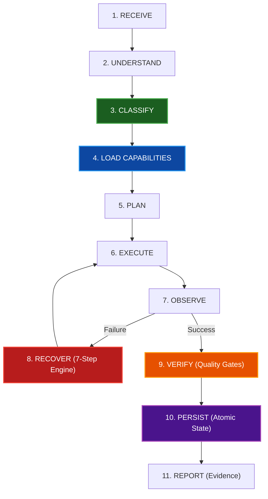

<div align="center">

# BUDDS-RULES v2.0 ⚡

**Autonomous AI Agent Rules & Production Execution Framework**  
*End to end. Zero babysitting. Never give up.*

[](LICENSE)
[]()
[]()
[]()
[]()
[]()

---

> *"The agent must NEVER give up on a user's task simply because an attempt failed. Human intervention during execution is a failure signal. Failure is a signal to change strategy, not a reason to surrender."*  
> — **BUDDS-RULES Manifesto**

---

</div>

## 💡 What it does

```
You:     "Implement a JWT authentication service with edge-case tests"
Agent:   [RECEIVE]          Request parsed into explicit execution objectives
         [UNDERSTAND]       Objectives identified: JWT auth, test assertions, zero regressions
         [CLASSIFY]         Domains: [development, testing] | Language: TypeScript | Complexity: moderate
         [LOAD CAPABILITIES]Loaded modular playbooks & dependencies (NO /skill required)
         [PLAN]             Milestones with dependency tracking generated by Specialist Team
         [EXECUTE]          Implementation authored with clean code principles
         [OBSERVE]          Immediate exit code, syntax & output inspection
         [RECOVER]          7-Step Infinite Problem-Solving triggered if errors arise (Self-Healing)
         [VERIFY]           Quality Gates validated: syntax checks, test execution, exit code 0
         [PERSIST]          Atomic write & state backup recorded in .budds/state.json
         [REPORT]           Delivered production code + concrete evidence report
You:     Review results, not struggle.
```

**Zero Manual Friction**: Users never need to browse `/skill` directories or manually activate playbooks. BUDDS-RULES classifies task intent and dynamically activates relevant modules automatically.

---

## 🏗️ Architecture



### Core Architecture Components

1. **Canonical Always-On Core (`AGENTS.md`)**:
   Single source of truth for behavioral commandments: `NEVER GIVE UP`, infinite problem solving, blocker handling, and persistence.
2. **Context-Based Skill Classifier v2.0 (`src/core/classifier.js`)**:
   Analyzes prompt syntax, file extensions, 9 programming languages, frameworks, and complexity.
3. **Automatic Skill Discovery (`src/skills/index.js`)**:
   Zero-touch modular playbooks with dependency resolution and fallback:
   - `development`: Full-stack architecture, clean code
   - `debugging`: Root-cause triage, self-healing
   - `testing`: Unit/integration test assertions
   - `research`: Documentation, API specs, and sitemaps
   - `automation`: CLI workflows, CI/CD, scripting
   - `documentation`: Technical specs, manuals, diagrams
4. **9 Modular Specialist Agents (`src/agents/`)**:
   - `architect`: Systems Architect
   - `coder`: Full-Stack Implementation Specialist
   - `debugger`: Root-Cause & Resilient Triage Specialist
   - `researcher`: Intelligence Specialist
   - `tester`: QA Verification Specialist
   - `reviewer`: Code Quality & Architectural Reviewer
   - `security`: Application Security & Vulnerability Auditor
   - `docs`: Technical Documentation & Architecture Specialist
   - `automation`: CLI & Workflow Automation Engineer
5. **Persistent Task State v2.0 (`src/core/state.js`)**:
   Atomic file writes (`state.tmp.*` -> `state.json`), automatic `state.backup.json` corruption recovery, milestone dependencies, interrupted task resumption, and sanitized execution logging.
6. **Advanced Recovery Engine v2.0 (`src/core/recovery.js`)**:
   Failure fingerprinting (MD5 of category + root snippet + method), duplicate attempt prevention, adaptive retry budgets, and human-readable blocker reports.
7. **Permission Manager & Security Model (`src/core/permissions.js`)**:
   Risk tiers (`READ`, `WRITE`, `EXECUTE`, `DANGEROUS`), automatic file backups, and secret sanitization.
8. **Quality Gates & Verification Engine (`src/core/verifier.js`)**:
   Domain-specific quality gates asserting syntax, compile, test, and documentation compliance.

---

## 🔌 Universal AI Agent Adapters

BUDDS-RULES features a unified adapter contract v2 (`detect`, `install`, `configure`, `activate`, `execute`, `verify`, `uninstall`, `getCapabilities`):

| Agent Environment | Configuration Path | Mode |
| :--- | :--- | :--- |
| **Google Antigravity IDE** | `AGENTS.md` + `GEMINI.md` | Canonical + Pointer Adapter |
| **Anthropic Claude Code** | `CLAUDE.md` / `~/.claude/CLAUDE.md` | Workspace & Global |
| **Cursor IDE** | `.cursorrules` + `.cursor/rules/budds-rules.mdc` | Multi-Format MDC |
| **OpenCode** | `opencode.json` / `~/.config/opencode/opencode.json` | Plugin Config |
| **Windsurf (Codeium)** | `.windsurfrules` | Workspace Rules |
| **GitHub Copilot** | `.github/copilot-instructions.md` | Instructions Spec |
| **OpenAI Codex & Universal CLI** | `AGENTS.md` | Universal Spec |

---

## 🚀 Interactive CLI (`budds`)

Manage BUDDS-RULES using the `budds` CLI:

```bash
# Display help and command matrix
node bin/budds.js --help

# Initialize BUDDS-RULES in workspace (.budds/)
node bin/budds.js init

# Install adapters for all agents or a specific agent
node bin/budds.js install
node bin/budds.js install --agent antigravity

# Install globally to home directory configuration
node bin/budds.js install --global

# Uninstall adapters cleanly
node bin/budds.js uninstall --agent cursor

# Run system health diagnostics
node bin/budds.js doctor

# Validate rule integrity and configuration
node bin/budds.js validate

# View active task status and recovery history
node bin/budds.js status

# Resume an interrupted task after crash or agent restart
node bin/budds.js resume

# View recent execution logs
node bin/budds.js logs

# List components and capabilities
node bin/budds.js list
node bin/budds.js adapters
node bin/budds.js skills
node bin/budds.js agents

# Run automated test suite
node bin/budds.js test
```

---

## 🧪 Testing

BUDDS-RULES includes 9 independent automated test suites:

```bash
npm test
# or
node tests/run-all.js
```

Test Coverage Matrix:
- ✅ **TaskClassifier**: Zero-touch classification, language/framework detection, complexity scoring
- ✅ **Universal Adapters (Contract v2)**: Unified contract verification across all 7 adapters
- ✅ **Persistent State**: Atomic writes, backup corruption recovery, interrupted task resumption
- ✅ **Recovery Engine**: Failure fingerprints, duplicate attempt prevention, adaptive retry budgets
- ✅ **Result Verifier**: Domain quality gates (programming, documentation, automation)
- ✅ **11-Stage Lifecycle**: Full lifecycle pipeline verification end-to-end
- ✅ **Permission Manager**: 4 risk tiers, automated backups, secret sanitization
- ✅ **Interactive CLI**: Verification of all 15 commands and options
- ✅ **Real-World Stress & Integration**: 4-state agent verification and subagent inheritance

---

## 📜 Canonical Commandments

1. **NEVER GIVE UP.**
2. **NEVER ABANDON.**
3. **NEVER STOP PREMATURELY.**
4. **FAILURE IS A SIGNAL TO CHANGE STRATEGY, NOT A REASON TO SURRENDER.**
5. **THE OBJECTIVE IS COMPLETION.**
